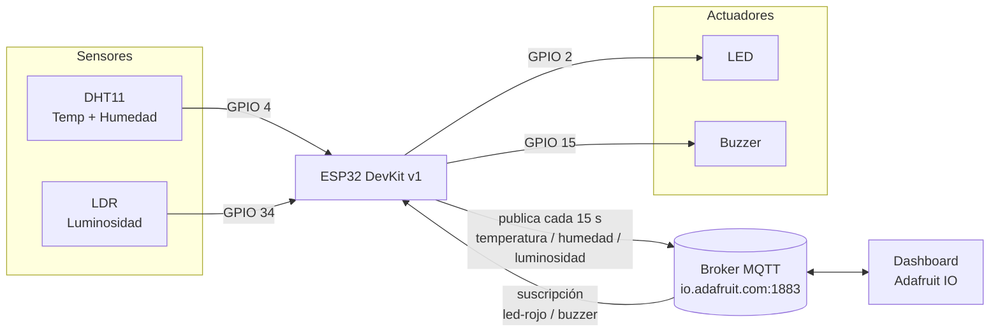
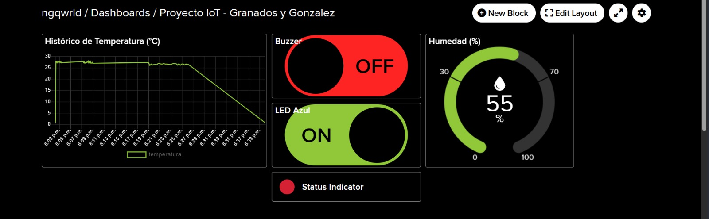

# 🌡️ Proyecto Integrador IoT – ESP32 + Adafruit IO

Monitoreo de temperatura, humedad y luminosidad con un **ESP32 DevKit v1**, publicados por **MQTT** en **Adafruit IO**, con control remoto de un LED y un buzzer desde un dashboard web.

**Asignatura:** Internet de las Cosas (IoT) – UTS
**Integrantes:** Neiver Granados & Kevin Gonzalez

---

## 📐 Arquitectura



Versión en texto:

```
 [DHT11] [LDR]                         [LED] [Buzzer]
     \     /                               ^     ^
      v   v          WiFi / MQTT           |     |
      [ESP32] <------------------------> [Broker Cloud: Adafruit IO] <----> [Dashboard web]
        publica: temperatura, humedad, luminosidad
        escucha: led-rojo, buzzer
```

### Feeds MQTT

| Feed | Dirección | Contenido |
|---|---|---|
| `temperatura` | ESP32 → Cloud | °C (1 decimal) |
| `humedad` | ESP32 → Cloud | % (1 decimal) |
| `luminosidad` | ESP32 → Cloud | Lectura ADC 0–4095 |
| `led-rojo` | Cloud → ESP32 | `1`/`ON` o `0`/`OFF` |
| `buzzer` | Cloud → ESP32 | `1`/`ON` o `0`/`OFF` |

Los tópicos tienen el formato `<usuario>/feeds/<feed>`.

---

## 🔌 Conexiones de hardware

| Componente | Pin del ESP32 |
|---|---|
| DHT11 (señal) | GPIO 4 |
| LDR (divisor de voltaje) | GPIO 34 |
| LED | GPIO 2 |
| Buzzer | GPIO 15 |

---

## 🛠️ Cómo replicar el proyecto

### 1. Requisitos
- Placa ESP32 DevKit v1, sensor DHT11, LDR con resistencia de 10 kΩ, LED y buzzer.
- [Arduino IDE](https://www.arduino.cc/en/software) 2.x.
- Cuenta gratuita en [Adafruit IO](https://io.adafruit.com).

### 2. Instalar la placa y las librerías (en el Arduino IDE)
1. `Archivo > Preferencias > URLs adicionales` y agrega:
   `https://raw.githubusercontent.com/espressif/arduino-esp32/gh-pages/package_esp32_index.json`
2. `Herramientas > Placa > Gestor de tarjetas` → instala **esp32 by Espressif Systems**.
3. `Herramientas > Administrar bibliotecas` → instala:
   - **PubSubClient** (Nick O'Leary)
   - **DHT sensor library** (Adafruit)
   - **Adafruit Unified Sensor**

### 3. Crear los feeds en Adafruit IO (en el navegador)
En `Feeds > New Feed` crea exactamente estos 5 nombres:
`temperatura`, `humedad`, `luminosidad`, `led-rojo`, `buzzer`.

### 4. Crear el dashboard (en el navegador)
`Dashboards > New Dashboard` y agrega bloques:
- **Line Chart** → feed `temperatura`
- **Gauge** → feed `humedad` (rango 0–100)
- **Toggle** → feed `led-rojo`
- **Toggle** → feed `buzzer`

### 5. Configurar credenciales (en tu PC, en la carpeta del proyecto)
```bash
cd main
cp config.example.h config.h
```
Abre `main/config.h` y escribe tu SSID, tu contraseña WiFi, tu usuario de Adafruit IO y tu **AIO Key** (en Adafruit IO: ícono de llave amarilla).

> ⚠️ `config.h` está en `.gitignore`. Nunca subas claves reales a GitHub.

### 6. Cargar el programa (en el Arduino IDE)
1. Abre `main/main.ino`.
2. `Herramientas > Placa` → **ESP32 Dev Module**.
3. Selecciona el puerto COM correcto y pulsa **Subir**.
4. Abre el **Monitor Serie** a **115200 baudios**. Debes ver `[MQTT] Status : CONECTADO A ADAFRUIT IO EXITOSAMENTE`.

### 7. Verificar
- Cada 15 s aparecen datos nuevos en el dashboard.
- Al mover los toggles, el monitor serie muestra el comando recibido y el LED o buzzer responde.

---

## 📸 Capturas del dashboard



*Dashboard "Proyecto IoT – Granados y Gonzalez": histórico de temperatura, humedad (55 %), buzzer en OFF y LED en ON.*

---

## 🔒 Seguridad de credenciales

- El SSID, la contraseña WiFi y la AIO Key viven solo en `main/config.h`, ignorado por Git.
- El repositorio incluye `config.example.h` como plantilla sin datos reales.
- Si una clave se expone, regenérala en Adafruit IO (**AIO Key > Regenerate Key**).

## 📁 Estructura

```
.
├── .gitignore
├── README.md
├── docs/dashboard.png
└── main/
    ├── main.ino
    ├── config.example.h
    └── config.h        (local, ignorado por Git)
```
